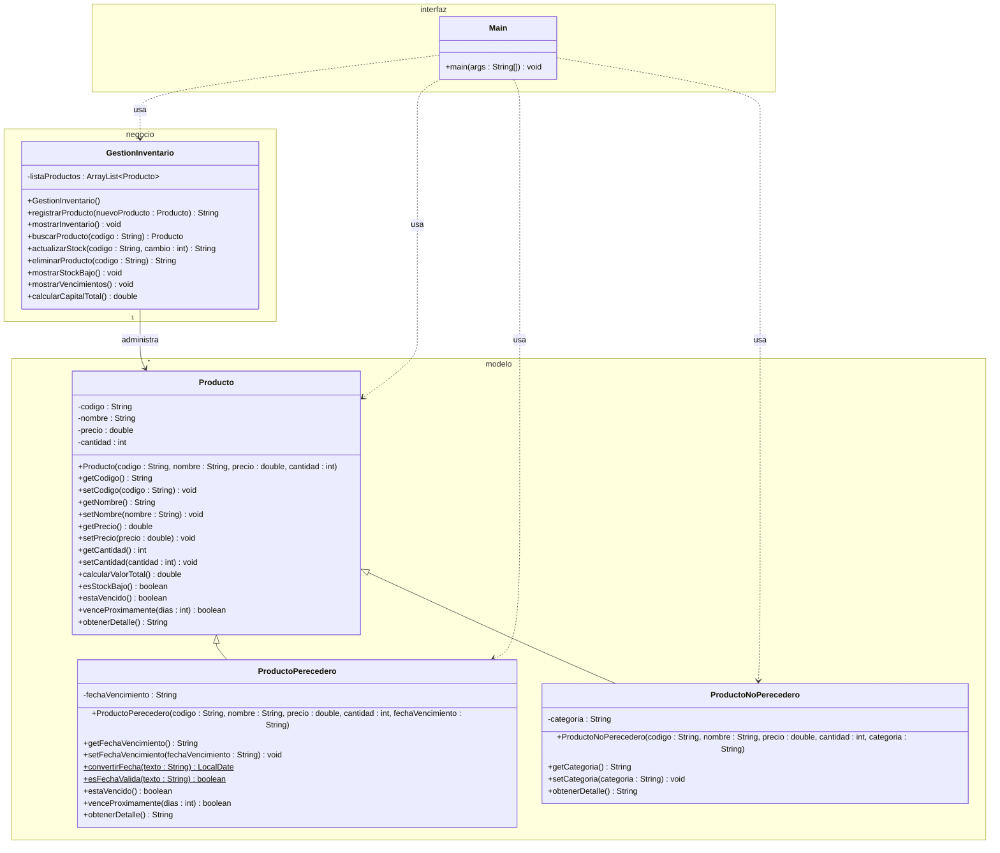

# S9-RC1_Resoluci-nDeProblemas
Realizar esta actividad en el grupo del proyecto final

# Sistema de Inventario - Peluquería "Glamour & Estilo"

Proyecto de **Programación II (ISWZ1103)**. Aplicación en Java, de consola, para gestionar el inventario de una peluquería usando Programación Orientada a Objetos (encapsulamiento, herencia y polimorfismo).

## Integrantes

- Sebastian Simba
- Gabriel Anchaluisa
- Gabriel Torres
- Ariel Quezada
- Joseph Oña

## Problema que resuelve

La peluquería no tiene control de sus productos: se agotan insumos sin aviso, se vencen tintes y tratamientos, y no se sabe cuánto dinero hay invertido en inventario. Este sistema permite registrar, consultar y controlar los productos y genera alertas de stock bajo y vencimientos.

## Funcionalidades

1. Registrar insumos perecederos (tintes, shampoos, tratamientos).
2. Registrar herramientas y equipos (secadores, tijeras, planchas).
3. Ver el inventario completo y su valor total.
4. Buscar un producto por código.
5. Actualizar stock (entradas y salidas).
6. Eliminar un producto.
7. Reporte de stock bajo (3 unidades o menos).
8. Reporte de productos vencidos y por vencer (próximos 30 días).

## Estructura del proyecto

```
src
├── modelo
│   ├── Producto.java              (clase padre)
│   ├── ProductoPerecedero.java    (hereda de Producto)
│   └── ProductoNoPerecedero.java  (hereda de Producto)
├── negocio
│   └── GestionInventario.java     (lógica y validaciones)
└── interfaz
    └── Main.java                  (menú en consola)
```

## Conceptos de POO aplicados

- **Encapsulamiento:** los atributos son `private` y se accede con getters y setters.
- **Herencia:** `ProductoPerecedero` y `ProductoNoPerecedero` heredan de `Producto`.
- **Polimorfismo:** `obtenerDetalle()`, `estaVencido()` y `venceProximamente()` se sobrescriben en las clases hijas.

## Requisitos

- Java JDK [versión que usan, ej. 17 o 21]
- IntelliJ IDEA (u otro IDE de Java)

## Cómo ejecutarlo

1. Clonar el repositorio:
   ```
   git clone https://github.com/Kinitox/S9-RC1_Resoluci-nDeProblemas.git
   ```
2. Abrir la carpeta del proyecto en IntelliJ IDEA.
3. Abrir `src/interfaz/Main.java`.
4. Ejecutar con el botón verde (Run) o con `Shift + F10`.
5. Usar el menú escribiendo el número de la opción.

## Ejemplo de uso

```
1. Registrar Insumo Químico / Perecedero
...
Seleccione una opción: 1
Ingrese Código: TIN-01
Ingrese Nombre del Producto: Tinte Rubio
Ingrese Precio Unitario ($): 5.50
Ingrese Cantidad en Stock: 10
Ingrese Fecha de Vencimiento (DD/MM/AAAA): 15/08/2027
ÉXITO: Producto 'Tinte Rubio' registrado correctamente en la peluquería.
```

## Documentación

El informe técnico en PDF incluye la formulación del problema, las alternativas, la selección con el diagrama UML y los casos de prueba.

## Arquitectura del sistema

